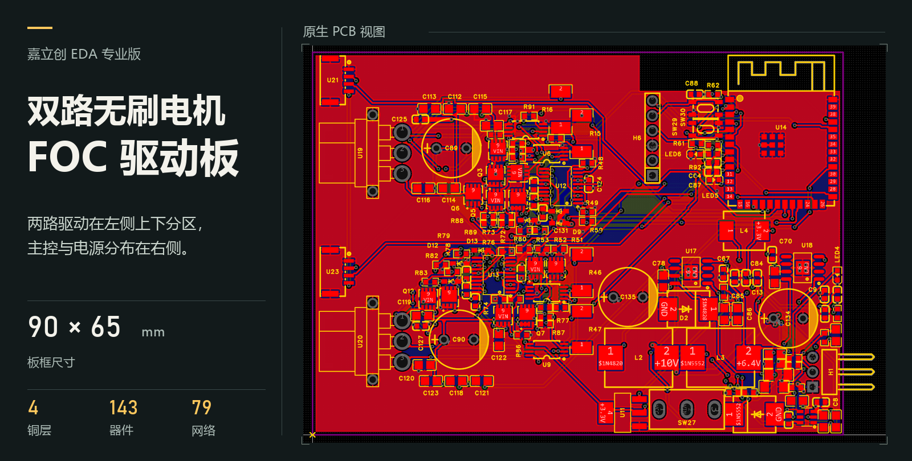
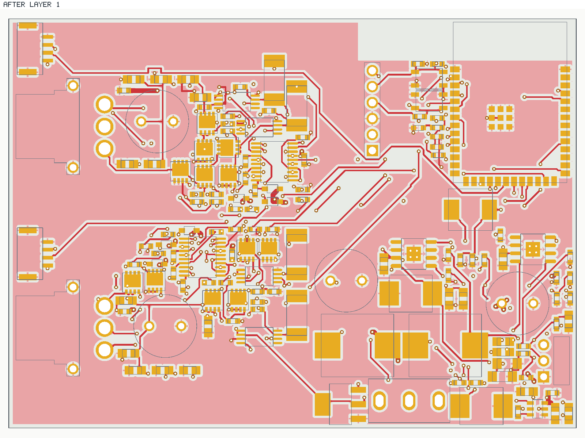
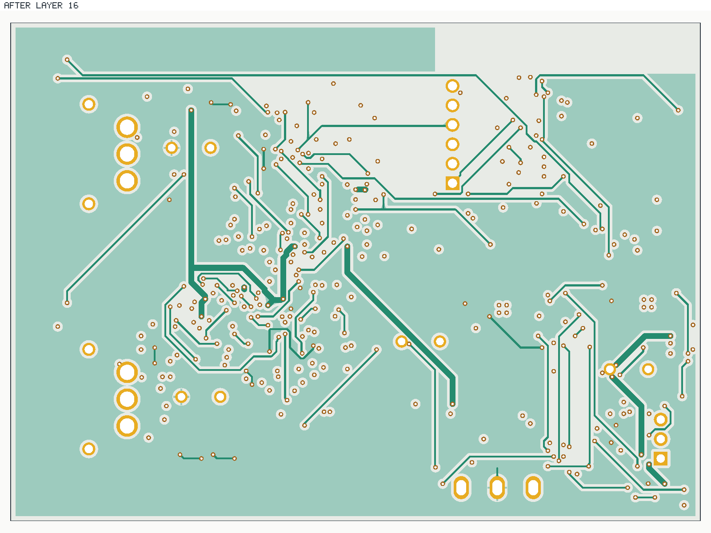
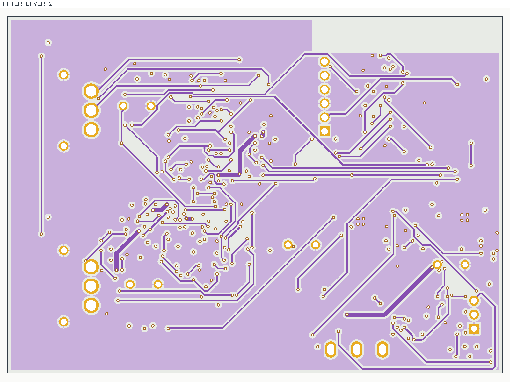
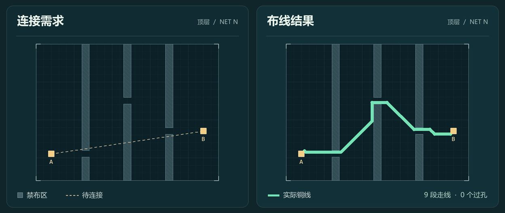

<div align="center">


<p>
  
  
  
  
  <a href="https://github.com/xiaolimao0610/pcb-layout-routing-skill/discussions"></a>
</p>

**让 AI 在嘉立创 EDA 专业版里按功能整理原理图，在本地计算 PCB 布局布线，再写回工程逐项核对。**

[本地试跑](#-本地试跑) · [给 AI 的入口](SKILL.md) · [完整手册](MANUAL.md) · [文档导航](#-文档导航) · [参与讨论](https://github.com/xiaolimao0610/pcb-layout-routing-skill/discussions)

</div>

<br>

## ✦ 能做什么

<table>
<tr>
<td width="33%" valign="top">

### 🧩 原理图重排
按功能分块，块内直接连线。合页后逐引脚核对网表，差异为零才通过。

<sub>→ [原理图工作流](SCHEMATIC_LAYOUT.md)</sub>

</td>
<td width="33%" valign="top">

### 🛰️ 布局与布线
参考原厂手册安排器件分区，支持多层信号布线、密脚扇出、差分换层与失败网络局部重布。

<sub>→ [分区布局](COLD_START_LAYOUT.md) · [密集布线](DENSE_ROUTING.md)</sub>

</td>
<td width="33%" valign="top">

### ✅ 写回与核对
写回前核对 UUID 与来源指纹、备份工程，每次写回任务只派发一次。保存后核对读回几何与原生 DRC。

<sub>→ [嘉立创写回](eda/README.md) · [质量契约](QUALITY_CONTRACT.md)</sub>

</td>
</tr>
</table>


<br>

<a name="双路-foc-驱动板"></a>

## ✦ 案例一 · 双路 FOC 驱动板

[](docs/cases/foc-board.png)

<div align="center">

| 板框尺寸 | 铜层 | 器件 | 网络 | 原生 DRC 连接 / 间距报错 |
| :---: | :---: | :---: | :---: | :---: |
| **90 × 65 mm** | **4** | **143** | **79** | **0 项** |

</div>

右上角的天线在四层铜图上都留出了净空，图片取自实际保存后的设计。

> [!NOTE]
> 仍有 **1 项原理图与 PCB 网表不匹配**，整板验收尚未通过。

<details>
<summary><strong>展开四层铜图</strong> · 对照走线、铺铜与天线净空</summary>

<br>

四张图来自同一次板面读回，方向和比例一致。点击可查看原图。

| L1 顶层 · 信号与地铜 | L2 内层 · GND 参考面 |
| :--- | :--- |
| [](docs/cases/foc-top.png) | [](docs/cases/foc-inner-ground.png) |
| **L3 内层 · VIN 电源铜与信号通道** | **L4 底层 · 信号与地铜** |
| [](docs/cases/foc-inner-power.png) | [](docs/cases/foc-bottom.png) |

</details>

<br>

<a name="醒狮六路电机驱动原理图"></a>

## ✦ 案例二 · 醒狮六路电机驱动原理图

六路驱动原来分在两页，同一通道的输入电阻、驱动芯片和电机接口要靠标签对照。重排后，六路驱动集中在一页。对照下图的第一路电机，沿驱动芯片 U1 的两根输出线就能找到接口 J2。

[](docs/cases/schematic.png)

<div align="center">

| 整份原理图 | 重排前 | 重排后 |
| :--- | :---: | :---: |
| 页数 | 5 | **4** |
| 可沿页内导线追到另一器件的引脚 | 0 / 355 | **299 / 355** |
| 逐引脚网表差异 | — | **0** |

</div>

重新打开工程后核对了 **117 个器件、383 个引脚、83 个网络**，其中 28 个引脚原本未连接。普通 ERC 通过，严格 ERC 仍有 3 条警告。

<br>

<a name="本地试跑"></a>

## ✦ 本地试跑

在仓库根目录运行以下命令，可用合成电路试读布通摘要、失败网络诊断和本地完整报告。**试跑无需启动嘉立创。**

```sh
python -m pip install -r requirements.txt
python -B -X utf8 -m unittest discover -s tests -p test_cli_summary.py -v
```

已有 PCB 任务文件时，可以在本地计算布局布线候选。

```sh
python -B pcb_pipeline.py solve --input task.json --output-dir run-01
```

<details>
<summary><strong>窄通道布线示例</strong> · 连接需求与实际铜线对照</summary>

<br>



</details>

<br>

## ✦ 文档导航

| 我想要…… | 打开对应资料 |
| :--- | :--- |
| 首次安装、搭建桥接 | [使用手册](MANUAL.md) · [桥接安装](bridge/README.md) |
| 原理图功能分块、合页、网表核对 | [原理图工作流](SCHEMATIC_LAYOUT.md) |
| 新布局、换板型、器件散落板外 | [原厂手册与配权](LAYOUT_REFERENCE_AND_WEIGHTS.md) · [分区初始布局](COLD_START_LAYOUT.md) |
| BGA、密脚、差分换层、失败网络重布 | [密集布线](DENSE_ROUTING.md) · [局部修复与制造铜补证](AUTOMATION_AND_GERBER.md) |
| 装配、丝印、回流、载流检查 | [质量契约](QUALITY_CONTRACT.md) |
| 导出工程数据、查输入字段 | [工程采集](CONTEXT_CAPTURE.md) · [输入契约](INPUT_CONTRACT.md) |
| 接续已有工程、超时恢复 | [状态与恢复](PROJECT_STATE.md) |
| 嘉立创接口与写回 | [嘉立创接口](eda/README.md) |

<br>

## ✦ 参与与许可

欢迎分享难布的案例或一起改进算法：[报告问题](https://github.com/xiaolimao0610/pcb-layout-routing-skill/issues) · [贡献指南](CONTRIBUTING.md) · [参与讨论](https://github.com/xiaolimao0610/pcb-layout-routing-skill/discussions)

> [!IMPORTANT]
> 项目允许**非商业**使用、修改与分享；商用请事先取得相应权利人的书面许可。详见 [许可条款](LICENSE.md)。
