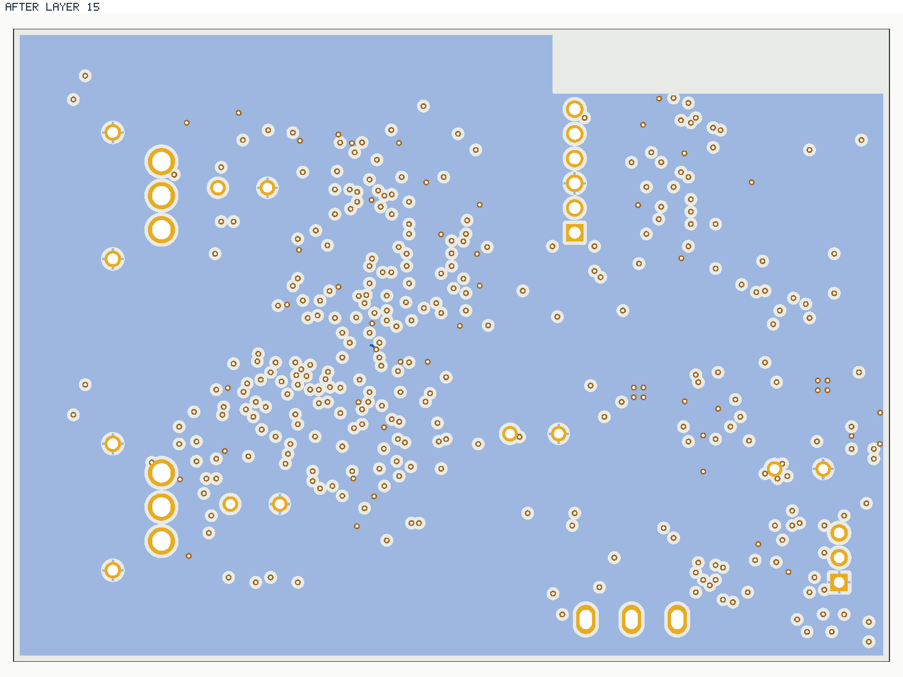
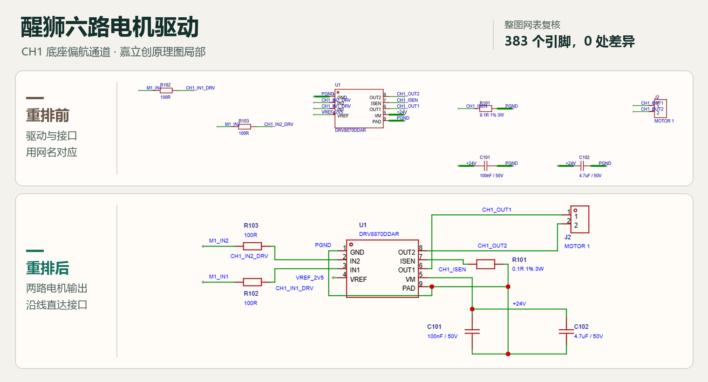

# PCB 布局布线辅助 Skill

让 AI 在嘉立创 EDA 专业版里按功能整理原理图，在本地计算 PCB 布局布线，再写回工程核对。下面两个案例取自实际保存后的设计。

[本地试跑](#本地试跑) · [给 AI 的入口](SKILL.md) · [完整手册](MANUAL.md) · [参与讨论](https://github.com/xiaolimao0610/pcb-layout-routing-skill/discussions)

## 双路 FOC 驱动板

[](docs/cases/foc-board.png)

右上角的天线在四层铜图上都留出了净空。保存后运行嘉立创原生 DRC，连接和间距报错均为 **0 项**。仍有 **1 项原理图与 PCB 网表不匹配**，整板验收尚未通过。

<details>
<summary><strong>展开四层铜图</strong> · 对照走线、铺铜与天线净空</summary>

四张图来自同一次板面读回，方向和比例一致。点击可查看原图。

| L1 顶层 · 信号与地铜 | L2 内层 · GND 参考面 |
| :--- | :--- |
| [](docs/cases/foc-top.png) | [](docs/cases/foc-inner-ground.png) |
| **L3 内层 · VIN 电源铜与信号通道** | **L4 底层 · 信号与地铜** |
| [](docs/cases/foc-inner-power.png) | [](docs/cases/foc-bottom.png) |

</details>

## 醒狮六路电机驱动原理图

六路驱动原来分在两页，同一通道的输入电阻、驱动芯片和电机接口要靠标签对照。重排后，六路驱动集中在一页。对照下图的第一路电机，沿驱动芯片 U1 的两根输出线就能找到接口 J2。

[](docs/cases/schematic.png)

| 整份原理图 | 重排前 | 重排后 |
| :--- | ---: | ---: |
| 页数 | 5 | **4** |
| 可沿页内导线追到另一器件的引脚 | 0 / 355 | **299 / 355** |

重新打开工程后核对了 **117 个器件、383 个引脚、83 个网络**，逐引脚网表差异为 **0**。其中 28 个引脚原本未连接。普通 ERC 通过，严格 ERC 仍有 3 条警告。

## 本地试跑

在仓库根目录运行以下命令，可用合成电路试读布通摘要、失败网络诊断和本地完整报告。试跑无需启动嘉立创。

```sh
python -m pip install -r requirements.txt
python -B -X utf8 -m unittest discover -s tests -p test_cli_summary.py -v
```

[原理图画法](SCHEMATIC_LAYOUT.md) · [密集布线策略](DENSE_ROUTING.md) · [嘉立创接口](eda/README.md) · [窄通道布线示例](docs/overview.png)

欢迎分享难布的案例或一起改进算法。项目允许非商业使用、修改与分享，商用请事先取得相应权利人的书面许可。[报告问题](https://github.com/xiaolimao0610/pcb-layout-routing-skill/issues) · [贡献指南](https://github.com/xiaolimao0610/pcb-layout-routing-skill/blob/main/CONTRIBUTING.md) · [许可条款](https://github.com/xiaolimao0610/pcb-layout-routing-skill/blob/main/LICENSE.md)
